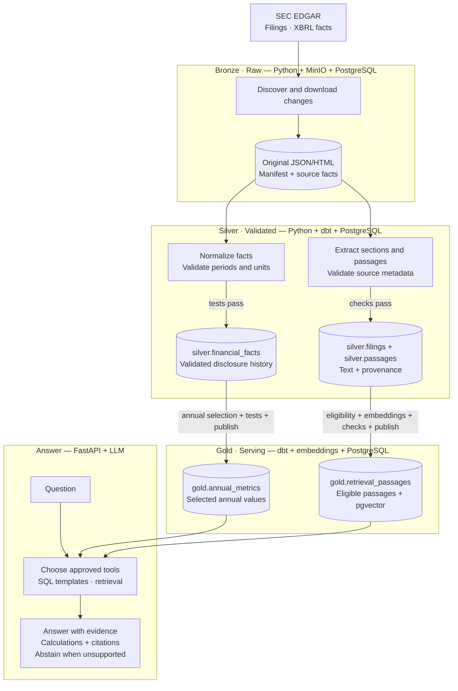

# SEC Research Assistant

Build a company research assistant that combines financial calculations with cited explanations from SEC filings. Example: “How did revenue change, and what reasons did the company report?” SQL calculates the change; document retrieval supplies supporting passages.

## MVP and stack

Start with five companies, three years of annual filings (10-K), and revenue, net income, and operating cash flow. Support single-company questions first; exclude investment recommendations, autonomous SQL generation, and real-time ingestion.

Use Python, Airflow, MinIO (S3-compatible raw storage), PostgreSQL + pgvector, dbt, FastAPI, an embedding model, and an LLM API. Run locally with Docker Compose; use a small web interface or API client for questions.

## Medallion layers

Build a **bronze → silver → gold** pipeline: preserve source data, validate detailed records, then publish application-ready datasets. These are logical quality layers implemented with MinIO and PostgreSQL schemas in the existing stack. See the [medallion architecture reference](https://docs.databricks.com/aws/en/lakehouse/medallion).

| Layer | Storage and datasets | Responsibility |
| --- | --- | --- |
| Bronze — raw | MinIO `bronze/` objects; PostgreSQL `bronze.manifest` and `bronze.source_facts` | Preserve original JSON/HTML snapshots and source-faithful fact records, with download metadata and hashes. |
| Silver — validated | PostgreSQL `silver.filings`, `silver.financial_facts`, and `silver.passages` | Type, normalize, deduplicate, and validate facts; extract readable passages with source references. Retain valid disclosure history. |
| Gold — serving | PostgreSQL `gold.annual_metrics` and `gold.retrieval_passages` with pgvector | Apply annual-value and supersession rules; publish selected metrics and eligible passages with embeddings and citation metadata. |

Every silver record must reference its bronze source; every gold record must reference its silver inputs. FastAPI reads only published gold datasets. Failed records remain traceable in quarantine and do not advance; failed builds leave the last successful gold publication available.

## Architecture

Airflow orchestrates ingestion, layer transformations, quality checks, and gold publication. FastAPI serves questions independently.

## Workflow and rules

1. **Ingest bronze:** query SEC submission histories and Company Facts; fetch selected filings from EDGAR Archives. Follow SEC access guidance, identify the client, and throttle requests. Save original bytes before parsing. Preserve changed responses as new hash-addressed objects; never overwrite prior snapshots. Record CIK, accession, URL, retrieval time, hash, and processing status in `bronze.manifest`; unpack source facts into `bronze.source_facts` without business filtering.
2. **Validate silver:** build typed financial facts with dbt and extract filing sections and bounded passages with Python. Deduplicate exact disclosures while retaining amendments and restatement history. Check required fields, units, periods, and source links; quarantine failures with their bronze references and reasons. Silver is built from persisted bronze, not directly from SEC requests.
3. **Publish gold:** derive `gold.annual_metrics` from validated silver facts using documented concept mappings and annual-value selection rules. Do not mix quarterly, year-to-date, annual, or differing-unit values. Derive `gold.retrieval_passages` from validated silver passages, embedding eligible content and excluding superseded passages from default retrieval. Preserve period, filing date, concept, accession, section, hash, model version, and upstream references as applicable. Build candidate outputs and pass quality checks before atomically publishing the gold build.
4. **Answer from gold:** validate company, metric, and period, then call parameterized, read-only SQL templates and/or metadata-filtered retrieval. Restrict the API database role to published gold datasets. Calculate numbers in SQL, provide source links and filing sections, and distinguish reported explanations from inferred conclusions. Missing or conflicting evidence triggers an explicit limitation or abstention.
5. **Operate:** retries must not duplicate objects, facts, or passages. Rebuild silver and gold from bronze for backfills or corrected processing; reuse embeddings only when content, processing version, and model version match. Report freshness, quarantined/failed items, answer latency, and API cost. Keep credentials in environment variables and out of Git.

## Implement in order

1. Create Compose services, the three PostgreSQL schemas, and a Python ingestor for one company; persist bronze files, manifest, and source facts.
2. Build and test silver financial facts, then publish the gold annual metrics mart with source lineage.
3. Add silver filing/passage extraction, then gold embeddings and retrieval returning cited passages.
4. Add FastAPI question handling, approved tools restricted to gold, and evidence-based answer generation.
5. Schedule bronze → silver checks → gold build/checks → publication in Airflow; demonstrate a duplicate rerun, a bronze-only rebuild, and recovery from download and validation failures.
6. Expand to five companies and evaluate 30–50 manually checked questions covering numerical, document, mixed, and unanswerable requests. Report numeric correctness, retrieval recall, citation support, abstention behavior, latency, and cost; include prompt-injection cases where document text must remain data.

**Done:** a fresh checkout can ingest the sample scope and serve cited answers using documented commands. Bronze is preserved, silver and gold are rebuildable with quality gates, and FastAPI reads only published gold. Reruns are idempotent, each answer is traceable through gold → silver → bronze to SEC filings, and an evaluation report records actual results and limitations.

## Data and references

- [SEC APIs: submission histories and XBRL facts](https://www.sec.gov/search-filings/edgar-application-programming-interfaces)
- [EDGAR search: identify companies and inspect filings](https://www.sec.gov/edgar/search/)
- [SEC developer and access guidance](https://www.sec.gov/about/developer-resources)

Portfolio focus: incremental ingestion, reproducible transformations, lineage, recovery, and evaluated AI retrieval over the same governed data.
